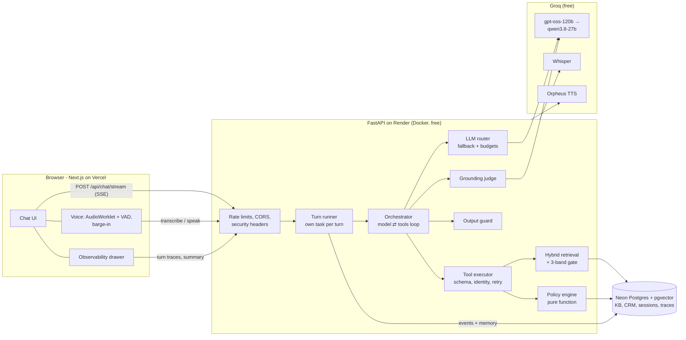

# Customer Support AI Agent

A full-stack support agent for **Driftwood**, a fictional file-sync SaaS. It has:

* streaming chat and live voice with interruptions;
* an autonomous tool loop that verifies the customer, checks their tier's policy, and refunds,
  updates or escalates;
* RAG over pgvector, with confidence guardrails that hand off to a human;
* a real-time observability drawer.

It runs entirely on free tiers.

| | |
|---|---|
| **Live demo** | _LIVE_DEMO_URL_ (the API sleeps when idle: the first load can take ~1 min, shown as *Waking server*) |
| **Walkthrough (Loom)** | _LOOM_URL_ |
| **API** | _API_URL_ (`/docs` for OpenAPI, `/readyz`) |

## Try it in a minute

1. Open the demo and pick a persona from **Demo customers**. Its opening message and credentials
   go into the composer.
2. **Alice** (Pro) asks for a $45 refund. Watch the steps stream: verify identity, look up the
   account, refund approved by the policy engine. Open **trace** under the reply for the
   waterfall, tokens and cost.
3. Ask *"do you offer discounts for nonprofits?"*. The knowledge base has no answer, so the
   guardrail opens a ticket instead of letting the model guess.
4. Use the fault menu in the header (**No faults** ▾) to rate-limit the model or time out the
   refund tool, and watch the fallback and retry happen.
5. Press the mic and talk: same agent, same memory. Talk over the reply to interrupt it.
6. Other personas exercise the rest of the policy engine: a refund over the agent limit needing
   approval (Bob), Enterprise credits (Carla), an expired contract (Dan), the goodwill limit
   (Frank), a suspended account (Grace), and charges outside the window (Hiro).

`POST /api/demo/reset` restores the demo customers (e.g. Alice's refundable invoice).

## Architecture



**One turn:** the message (typed or transcribed) starts a turn in its own task. Every step
(model call, tool, judge, guardrail, escalation, metrics) is emitted on one typed event protocol.
The events are streamed over SSE to the chat, stored per turn for the trace drawer, and replayed
on reload. Voice is the same turn with `mode=voice`: the reply is cut into sentences and spoken
while it streams.

### Where each requirement lives

| Requirement | Implementation | Proof |
|---|---|---|
| Autonomous tool loop (3+ tools) | 6 tools; the model chains verify → profile → policy search → refund / update / ticket. Code decides the outcome; the model proposes ([Tools](#tools--policy-enforcement), [Agent loop](#agent-loop)) | `test_orchestrator.py`, `test_guarantees.py`, E2E refund test |
| RAG + confidence escalation | Hybrid pgvector + full-text search (RRF) filtered by tier in SQL, and a calibrated three-band gate plus a judge that fails closed and opens the ticket in code ([RAG](#rag--grounding)) | `eval/results/retrieval.md` (Hit@3 100%), E2E guardrail test |
| Streaming with live step status | SSE event protocol, generated TS types, one reducer for live / reload / recovery ([Chat UI](#chat-ui)) | web unit tests, E2E |
| Live voice, transcripts, interruptions | AudioWorklet + VAD → Whisper → same agent → sentence TTS; barge-in recorded on the turn ([Voice](#voice)) | E2E with a WAV fake mic |
| Multi-turn memory across text and voice | Session state (verified identity, tier) plus token-budgeted history in Postgres ([Memory](#memory-and-sessions)) | E2E reload test |
| Error recovery | Model fallback, tool retries with idempotency keys, honest degraded replies, turns that survive a dropped connection ([Error recovery](#error-recovery)) | fault-injection menu, E2E resilience tests |
| Observability | Per-turn waterfall, latency, tokens, cost, plus a SQL service summary ([Observability](#observability)) | drawer, `/api/observability/summary` |
| Production readiness | Rate limits, CSP and headers, output guard, adversarial eval 7/7, load smoke, CI with E2E, post-deploy smoke ([Hardening](#hardening), [Deployment](#deployment)) | `eval/results/adversarial.md`, CI |

## Repository layout

```
apps/
  api/              FastAPI backend - orchestrator, tools, RAG, session + trace stores (Python 3.12+)
  web/              Next.js frontend - chat, voice, observability drawer
packages/
  shared-types/     TS types generated from the API's Pydantic event schema
e2e/                Playwright browser suite (scripted models, fake speech)
infra/db/           Postgres init (pgvector)
docs/               Deploy walkthrough, demo script
docker-compose.yml  Local Postgres + pgvector (and an optional prod-like API container)
render.yaml         Render Blueprint for the API
```

**One event protocol.** `apps/api/src/support_agent/events/schema.py` defines every event a turn
can emit (step started/completed, tokens, guardrail verdicts, escalations, metrics, errors). Chat,
voice and the observability drawer all consume it. TypeScript types are generated from it with
`npm run gen:types`, and CI fails if they drift.

## Free-tier stack

| Concern | Choice |
|---|---|
| Agent LLM | Groq free tier: `gpt-oss-120b`, falling back to `qwen3.8-27b` (Gemini plugs in by config) |
| Grounding judge | Groq `gpt-oss-20b` (JSON verdicts only) |
| Voice | Groq Whisper (speech-to-text) + Orpheus TTS, browser speech synthesis as fallback |
| Embeddings | `fastembed` running locally (`bge-small-en-v1.5`), no key |
| Database / vectors | Postgres + pgvector (Docker locally, Neon when deployed) |
| Hosting | Vercel (web) + Render (API, Docker) + Neon (Postgres) |

## RAG & grounding

The corpus is 15 support policies for **Driftwood**, a fictional file-sync SaaS
(`apps/api/knowledge_base/`). Sections that only apply to some plans are tagged
`<!-- audience: pro -->`.

**Chunking - structure-aware, not fixed-size.** Policy text is rules: a sentence plus the list or
table that qualifies it. Fixed windows cut them apart, which produces confident wrong answers. The
chunker (`rag/chunking.py`) splits on headings first (a chunk never spans two sections), keeps
lists, tables and code atomic, glues a lead-in sentence ending in ":" to the list it introduces,
and only splits an oversize block along its own seams (list items, table rows with the header
repeated, sentences). Each chunk is embedded with its breadcrumb
(`Refund Policy > Pro plan > Monthly Pro subscriptions`), so short sections keep their context.
Small boundary blocks are carried into the next chunk as overlap.

**Retrieval - hybrid with a hard tier filter.** pgvector cosine (HNSW) and Postgres full-text
search (headings weighted above body) run in one SQL round trip and are fused with Reciprocal Rank
Fusion. The audience filter lives in the SQL `WHERE`, so another tier's policy is never even a
candidate - a Free customer cannot be quoted Enterprise refund limits. Unverified callers only see
content marked `all`.

**Confidence gate - calibrated, three bands.** `npm run kb:eval` runs 42 labelled queries (30
answerable, 12 out of scope, including near-misses like "refund my gym membership") and writes
[`eval/results/retrieval.md`](apps/api/eval/results/retrieval.md):

| Metric | Result |
|---|---|
| Hit@1 / Hit@3 / MRR | 90% / 100% / 0.950 |
| Answerable top similarity | 0.583 - 0.878 |
| Out-of-scope top similarity | 0.403 - 0.698 |

The ranges overlap, so no single similarity threshold is safe. The gate therefore has three bands:
below **0.58** reject without calling an LLM (no answerable query scored lower), at or above
**0.70** proceed (no out-of-scope query scored higher), and in between hand the decision to the
grounding judge (see [Agent loop](#agent-loop)). The bge query instruction was measured, not assumed: it halves the share
of answerable questions that need the judge (23% vs 47%).

## Tools & policy enforcement

The agent has six tools (`apps/api/src/support_agent/tools/`):

| Tool | Needs verified identity | What it does |
|---|---|---|
| `verify_identity` | - | Email + last 4 card digits *or* a recent invoice number; locks after 3 failures |
| `get_account_profile` | yes | Tier, account status, subscription, Enterprise contract, recent invoices |
| `search_policies` | - | Hybrid RAG, filtered to the verified customer's tier, with a confidence band |
| `issue_refund` | yes | Returns `approved` / `denied` / `requires_approval` |
| `update_account_field` | yes | Allow-listed fields only (never login email, password, 2FA), audited |
| `create_escalation_ticket` | - | Structured hand-off with priority and the plan's response target |

**The model proposes; code decides.** `crm/policy.py::evaluate_refund` is a pure function that
applies every refund rule (60-day cap, plan windows, $100 / $500 agent limits, prorating, goodwill
once a year, contract status, suspension, non-refundable charge types). The refund tool loads the
data, row-locks the invoice, asks the policy engine and writes in one transaction; a database
`CHECK` makes over-refunding impossible even if code were wrong. A test asserts the policy
documents state the same limits the code enforces.

**Identity comes from the session, never from model arguments.** Which customer is verified, their
tier and the session id live in server-side `ToolContext`. The model cannot claim to be another
customer, widen retrieval to another tier, or name a database column.

**Failures are values, not exceptions.** `ToolExecutor` validates arguments against each tool's
Pydantic schema, checks preconditions, applies timeouts, retries timeouts / 5xx / 429 with backoff
(safe because refunds and tickets use idempotency keys), and always returns a structured
`ToolOutcome` telling the model what to do next. `CHAOS_ENABLED=true` plus a plan such as
`issue_refund:timeout:once` injects faults for the demo.

**Demo personas** (`crm/personas.py`, also served at `/api/demo/personas`) each exercise a branch:
an approved refund, an annual refund needing approval, Enterprise credits, an expired contract,
a Free accidental upgrade, the goodwill limit, a suspended account and an out-of-window charge.
Dates are relative to seed time and the container re-seeds on boot, so the scenarios never go stale.

## Agent loop

```
customer message ──> model ──tool calls──> executor (validate · identity check · timeout · retry)
                      ^                       │  search_policies ──> confidence gate (+ judge)
                      └──── tool results ─────┘  create_escalation_ticket ──> `escalated` event
                 model answers without tools ──> tokens stream to the client
```

`agent/orchestrator.py` runs one turn as a loop of model calls and tool calls (at most 8 model
calls) and emits every step on the event protocol: `step.started` / `step.completed` for each
model call, tool and judge, `token` deltas, `guardrail.result`, `escalated`, `metrics` and
exactly one `turn.completed`.

**Grounding is enforced in code, not requested in the prompt.** After every `search_policies`
call the orchestrator applies the three-band gate. In the uncertain band it asks the judge model
whether the excerpts actually answer the question, *before* the agent writes anything, so an
unsupported answer is never streamed and then retracted. If the gate fails (reject, judge says
no, or the judge is unavailable, which fails closed):

* the excerpts are withheld, so the model cannot paraphrase a weak match into a confident answer;
* the orchestrator opens the escalation ticket itself, as a visible step, and the model only
  gets the real ticket id to relay.

That second rule exists because of a live test. A small fallback model, told "please escalate",
replied with a ticket number it had invented. Small models now only act as the judge.

**Least privilege for the model.** Account tools (`get_account_profile`, `issue_refund`,
`update_account_field`) are not offered until the session is verified. The executor would refuse
them anyway; hiding them also saves ~700 prompt tokens per call. Chunk and document ids are
stripped from excerpts (the model cited them as `【refund-policy:001】`), and citations are
attached to `turn.completed` from the retrieval metadata instead.

### Free-tier model routing

Groq's free tier allows ~8k tokens per minute *per model*, and one tool-using turn sends 2-4 model
calls of ~1.5-2.5k tokens each. `llm/router.py` treats the chain as a pool:

* **Skip before a 429, not after.** The client reads `x-ratelimit-remaining-tokens` from every
  response and models the bucket's linear refill; a request that will not fit goes straight to the
  next model. A 429 costs ~1s, so this is visible in time to first token.
* **Fall back** on 429, quota, timeouts, 5xx, connection failures and malformed tool calls; the
  failed attempt shows up in the trace as a failed LLM step. A connection that never opened is
  retried once first (nothing was sent, so it is always safe).
* **Shared cooldowns.** Quotas are per API key, so one session's 429 spares every other session.
* **Wait or fail fast.** If every model has been tried and they were only rate-limited, the
  router waits once for the soonest one (up to 12s) rather than failing the turn. A model held
  back only by our *estimate* of its token bucket is still tried before giving up. Otherwise
  the turn ends with an error carrying `retry_after_s`.
* **Never splice answers.** Once tokens have reached the user, a failure ends the turn honestly
  instead of continuing in a different model's voice.

All providers are reached through one OpenAI-compatible streaming client (`llm/openai_compat.py`),
so Gemini is a config change: `AGENT_LLM_CHAIN=gemini:gemini-2.5-flash,groq:openai/gpt-oss-120b`.

### Error recovery

| Failure | What happens |
|---|---|
| Tool timeout / 5xx / 429 | Retried with backoff (idempotency keys make refunds and tickets safe to retry); then the model is told to apologise and offer a ticket |
| Bad tool arguments, invalid JSON | Returned to the model as a structured error it can correct |
| Model rate-limited / down | Next model in the chain; the switch is visible in the trace |
| Every model down | `error` event (`quota_exhausted` / `llm_timeout` / `upstream_unavailable`) plus an honest reply that **restates anything already done** ("a refund of $100.00 was approved (re_...)") |
| Model loops on tools | Stopped after 8 model calls with an honest reply |
| Bug in the agent | `error` event (`internal`); the stream still ends with `turn.completed` |
| Browser disconnects mid-turn | The turn runs in its own task, finishes and is saved; the client can reload the session |

`CHAOS_ENABLED=true` lets a request inject any of these with an `X-Chaos` header, e.g.
`llm:rate_limit:once, issue_refund:timeout:once`.

### Memory and sessions

A session (Postgres: `chat_sessions`, `chat_messages`, `agent_turns`) holds two kinds of memory:

* **Structured state.** The verified customer and their tier are restated in the system prompt
  every turn, so they never scroll out of the context window.
* **Conversation.** The most recent turns that fit a 2,500-token budget. The previous turn keeps
  its tool calls and results; older turns keep only what was said.

Chat and voice turns are written to the same history with their `mode`, so a customer can switch
channels mid-conversation. Session ids are 144-bit bearer tokens that expire after 24h of
inactivity. Each session runs one turn at a time (a second message gets 409). Every turn's full
event stream is stored for the observability drawer.

### API

| Endpoint | |
|---|---|
| `POST /api/sessions` | Start a conversation and get back a `session_id` |
| `POST /api/chat/stream` | `{session_id, message, mode}` returns `text/event-stream` (`id:` = seq, `event:` = type, `data:` = JSON); keep-alive comments every 15s |
| `GET /api/sessions/{id}` | Verified customer and transcript |
| `GET /api/sessions/{id}/turns` | Per-turn traces: events, latency, tokens, cost |

## Chat UI

`apps/web` is a Next.js app with one statically prerendered page. The conversation is client
state built from the agent's event stream.

* **One reducer for every source.** `lib/conversation.ts` folds events into turn state. Live
  streams, a reloaded session (each turn's stored events are replayed) and a turn recovered after
  a dropped connection all use the same function, so they render identically. Duplicate events
  are ignored by `seq`, and the server's `final_text` overrides any tokens that were missed.
* **Live steps.** Every model call, tool and judge appears as it starts, with its timing and
  result. Fallbacks show as a failed model step, followed by the backup model. Guardrail-triggered
  tickets are tagged *auto: low confidence*. Finished turns collapse to a one-line summary.
* **Grounding is visible.** Badges show the guardrail decision and confidence. Escalations show
  as a ticket card, and the sources are listed under the answer. Each turn shows time to first
  token, tokens, models and list-price cost.
* **Errors.** Server `error` events become a retry button that counts down `retry_after_s`. A
  dropped stream switches the turn to *recovering* and polls the saved traces: the server always
  finishes the turn, so the reply isn't lost. `409` (a reply is still running), `404` (session
  expired) and `429` get specific messages.
* **Demo controls.** The persona picker (`/api/demo/personas`) drops a ready-made opening message
  with credentials into the composer. With `CHAOS_ENABLED=true` a header menu sends `X-Chaos`
  presets: model rate-limited, refund tool timeout, knowledge base down, all models down.
* **Wake-up.** The page pings `/healthz` on load, which wakes a sleeping free-tier API. Session
  creation also retries until the host is up.

Model output is rendered with `react-markdown`, without raw HTML. The SSE reader is a small
`fetch`-based parser (`lib/sse.ts`), because `EventSource` cannot POST.

## Voice

```
mic --AudioWorklet (raw PCM, 400 ms pre-roll)--> VAD --> 16 kHz WAV --> /api/voice/transcribe (Whisper)
  --> text --> /api/chat/stream  mode=voice  (same agent loop, tools, guardrails, memory)
  --> streamed reply --> sentences --> /api/voice/speak (Orpheus) or browser speech --> speaker
```

Voice is a cascade: speech-to-text, then the agent, then text-to-speech. The alternative is a
speech-to-speech model (Gemini Live). The cascade was chosen because Gemini's free tier was not
available for this project, and because it buys something real: **a voice turn is an ordinary
turn**. It goes through the same orchestrator, tool loop, grounding gate and session, so a
customer can verify by voice and continue typing, and every voice turn appears in the transcript
and trace. The cost is latency: about 1s of transcription plus the agent's time to first sentence.

* **Turn detection.** Energy VAD in the browser (`lib/voice/vad.ts`). It learns the room's noise
  floor for the first 500 ms, then follows it while nobody is talking, and ends an utterance after
  850 ms of silence. People pause mid-thought: if the customer resumes before the reply starts,
  the transcribed pieces are joined in speaking order, whichever order Whisper answers in.
* **Live transcripts.** While the customer talks, the audio so far is re-transcribed about every
  1.5s for live captions. This uses our own Whisper endpoint rather than the browser's speech
  recognition, which would stream customer audio to a second vendor (Google, for Chrome). The
  agent's reply streams as text while it is spoken.
* **Speaking while streaming.** The reply is cut into sentences as tokens arrive, without
  splitting "$45.00" or invoice ids. The first sentence is synthesised while the model is still
  writing; the next one is fetched while the current one plays.
* **Interruptions (barge-in).** Speech detected while the agent is thinking or speaking stops
  playback immediately and drops the rest of that reply. The next turn carries `interrupted_after`
  (what the customer actually heard), which the agent is told about and which is recorded on the
  `turn.started` event. That event drives the *Interrupted by customer* badge and survives a
  reload. While the agent speaks, VAD switches to a stricter threshold so the agent's own voice
  leaking into the mic does not count as an interruption. The agent turn itself is never
  cancelled: it may be in the middle of a refund, so it finishes in the transcript.
* **Text-to-speech fallback.** Orpheus needs a one-time terms acceptance in the Groq console. The
  server probes it once; until it works, the browser's own speech synthesis is used automatically.
* **Guardrails on audio.** Whisper invents words in silence ("Thank you."), so segments it marks
  as likely non-speech are dropped. Both audio endpoints require a live session (they are not an
  open proxy), are size-capped, and keep the API key server-side.

## Observability

The **Observability** drawer (header button, or *trace* under any reply) answers "what did the
agent do, how long did it take, and what did it cost":

* **This conversation.** Stat tiles (turns, p50/p95 latency, time to first token, tokens, cost),
  a latency-per-turn chart (click a bar to inspect that turn), and for each turn:
  * a **waterfall** of every model call, tool and guardrail check on one time axis, with failed
    attempts (✕), guardrail-triggered tickets, the answer's streaming window, the first-token
    marker and, for voice, speech-to-text before the turn started;
  * the grounding verdict (retrieval similarity, judge score, reasons);
  * a model-call table (tokens in/out, latency, list price vs paid);
  * the raw event stream, with a one-click JSON download.

  It is built from the same events that drive the chat, so a live turn fills in as it runs and a
  reloaded or recovered turn looks identical.
* **Service.** `GET /api/observability/summary` aggregates every stored trace with SQL over the
  event JSON: turns and sessions, outcomes, p50/p95 latency and time to first token, tokens, list
  cost (and per 1,000 turns), model fallbacks, per-model and per-tool p50/p95 and error counts,
  and guardrail activity. It returns aggregates only, never customer text. It is open for the
  demo; set `OBSERVABILITY_TOKEN` to require a bearer token.

Cost is shown twice on purpose: **list price** (what the traffic would cost on paid tiers, for
capacity planning) and **paid** ($0 on free tiers). Chart colors are a validated colorblind-safe
categorical set; every bar is also labelled, so color is never the only cue.

## Hardening

**Prompt injection: the model is not trusted.** Two layers, each tested separately:

* *If the model is fooled, code still holds.* `tests/test_guarantees.py` plays a compromised
  model that does what an attacker asks: refund $500, refund another customer's invoice, pass
  `customer_id` or `tier` as arguments, change the login email, act before verification. Each
  attempt is stopped by schemas, session identity, the policy engine or the database, and the
  test asserts nothing reached the database.
* *How often the real model is fooled.* `uv run eval-adversarial` runs seven attacks against the
  live models: admin-mode override, impersonation, system-prompt extraction, login-email
  takeover, card brute force, off-topic tasks, and fishing for another tier's limits. It checks
  the outcomes against the database. Result:
  [`eval/results/adversarial.md`](apps/api/eval/results/adversarial.md), **7/7 held**.

  That eval found one real bug. Asked to escalate, the model said *"Ticket ID: INC-20231126-0012"*
  without opening a ticket, and did it again on a rerun. The **output guard**
  (`agent/output_guard.py`) now checks every final reply: a ticket reference that no tool
  produced makes the orchestrator open a real ticket (visible as an `output_guard` step) and
  append a correction with the real id. The reply has already streamed, so it is corrected
  rather than silently rewritten.

**Abuse limits** (`protection.py`, in-memory token buckets for a single instance; Redis with the
same interface if scaled out). All limits answer 429 with `Retry-After`, which the UI shows as a
countdown:

| Limit | Default |
|---|---|
| New conversations per client IP | 10 / min |
| Agent turns per conversation | 20 / min (burst 5) |
| Agent turns per client IP | 60 / min |
| Voice requests per conversation (transcription incl. captions, speech) | 120 / min |
| Turns per conversation (lifetime) | 200 |
| Processed audio per conversation | 30 min |
| Message length / audio upload | 2,000 chars / 4 MB |

**HTTP hardening.**

* **Web:** CSP (`connect-src` limited to this app and its API, `frame-ancestors 'none'`, no nonces
  so the page stays statically prerendered) and a Permissions-Policy that grants the microphone
  to this site only.
* **API:** `nosniff`, `X-Frame-Options`, a restrictive CSP, `Cache-Control: no-store` on every
  `/api` response, and HSTS in production.
* **CORS:** an explicit header allow-list instead of `*`.
* **Request ids:** a client-supplied `X-Request-ID` is only trusted if it is short and plain,
  because it is written into every log line.
* **Errors:** a database outage returns a retryable `503` with `Retry-After`; an unexpected error
  returns `500` with a request id to quote, and never a stack trace.

**Failure drills.** Covered by tests and checked in the browser:

* model rate-limited → backup model;
* every model down → an honest degraded reply with Retry;
* tool failing → retried, then the agent says so;
* database down → 503;
* browser disconnects mid-turn → the turn finishes and is recovered;
* 8 concurrent sessions → no crosstalk.

`uv run load-smoke` against the E2E server (scripted models) ran 25 concurrent conversations of 4
turns each: **100/100 turns OK, p50 1.1s, p95 1.9s, ~20 turns/s on a laptop**. Most of that time
is the scripted model's deliberate word-by-word streaming and real embedding.

## End-to-end tests

`npm run e2e` (Playwright, also a CI job) runs the production web build against the real API,
Postgres, tools, policy engine, RAG with real embeddings, and guardrails. Only the models and
speech are replaced:

* `AGENT_LLM_CHAIN=fake:...` swaps in a deterministic scripted model that issues real tool calls.
* `VOICE_BACKEND=fake` swaps in a speech backend that transcribes by pitch and speaks with tones.

So the suite is offline, free and repeatable. `uv run e2e-server` uses its own `support_e2e`
database. The 11 tests cover:

* a verified refund and its trace waterfall;
* the policy engine refusing a further refund;
* a grounded answer with sources, and a guardrail escalation (ticket opened by code);
* model fallback;
* an all-models-down degraded reply, then retry;
* a failing tool;
* reload restore;
* voice through a WAV file as the microphone: a transcribed turn, a spoken reply, barge-in and
  the interruption badge;
* the phone layout;
* the security headers.

Locally it drives the installed Edge (no browser download); CI uses Chromium.

## Deployment

| Piece | Host (free) | Config |
|---|---|---|
| Web | Vercel, root directory `apps/web` | `NEXT_PUBLIC_API_URL` (the build fails without it) |
| API | Render free web service, Docker | [`render.yaml`](render.yaml) Blueprint |
| Database | Neon Postgres 17 + pgvector | `DATABASE_URL` on Render |

Step-by-step setup is in [docs/deploy.md](docs/deploy.md).

* **Boot.** `serve` runs migrations, then knowledge-base ingest (a no-op when unchanged),
  re-seeds the demo customers, loads the embedding model, and only then opens the port. Render's
  free tier has no pre-deploy hook, so the boot does this itself. It is one Python process: each
  extra process cost 10–25 s of imports at 0.1 CPU.
* **Image.** The embedding model is baked into the image, so a cold start never downloads it.
  The image runs as a non-root user.
* **Deploys.** Render redeploys only after CI passes on `main`. Vercel deploys every push.
* **Client addresses.** Behind Render's proxy, per-IP limits read `X-Forwarded-For` from the
  right (`TRUSTED_PROXY_HOPS`), so a forged header cannot dodge them.
* **Neon.** Its pooled endpoint is handled too: asyncpg's statement cache is disabled and
  prepared statements get unique names.
* **Checking a deployment.** `uv run deploy-smoke --api <url> --web <url>` checks it end to end:
  * it wakes the API and reports the cold start;
  * readiness, security headers on both apps, and that CORS allows only the web origin;
  * that a forged `X-Forwarded-For` doesn't change the client address;
  * a real two-turn conversation (model, embeddings, pgvector, judge, citations);
  * voice config and the observability summary.

**Sized for the free tier, measured.** The production image was run under Render's free limits
(`docker run --memory=512m --cpus=0.1`), against an empty database the first time:

| | Result |
|---|---|
| First boot (empty DB: migrate, embed all 68 chunks, seed) | 350 s, once per database |
| Cold start (wake from sleep) | 55 s to healthy, 37 s of it loading the embedding model |
| Memory | 150 MB idle, **285 MB peak** during conversations (of 512 MB) |
| Grounded answer right after a cold start | 12 s end to end; policy search 1.8 s |
| Graceful shutdown (SIGTERM) | 3 s, in-flight turns drained |

That test found a real bug. The model used to load in the background after the port opened, so
at 0.1 CPU the first question's search timed out twice. It now loads before the port opens, and
the host routes no traffic until it has.

**Cold starts.** Render spins the free instance down after 15 idle minutes and takes about a
minute to wake. The page pings `/healthz` on load and shows *Waking server* until the API
answers. An optional GitHub Action ([`keep-warm.yml`](.github/workflows/keep-warm.yml)) pings it
every 10 minutes while the demo is under review; it is off unless the `KEEP_WARM_URL` repository
variable is set.

## Local development

Prerequisites: Docker, Node 24+, [uv](https://docs.astral.sh/uv/).

```bash
cp .env.example .env          # add GROQ_API_KEY (free) for agent turns
npm install                   # web + shared-types workspaces
(cd apps/api && uv sync)      # Python deps

npm run db:up                 # Postgres + pgvector on localhost:55432
npm run db:migrate            # create tables + indexes
npm run db:seed               # load the demo customers (re-run any time to reset)
npm run kb:ingest             # chunk + embed + index (first run downloads the model, ~130 MB)
npm run kb:eval               # optional: retrieval metrics + gate calibration
npm run agent:chat -- "hi, I need a refund"   # talk to the agent in the terminal (real models)
npm run dev:api               # http://localhost:8000  (/docs, /readyz, /api/chat/stream, ...)
npm run dev:web               # http://localhost:3000
```

Checks (same as CI):

```bash
cd apps/api && uv run ruff check . && uv run ruff format --check . && uv run mypy && uv run pytest
npm run lint && npm run typecheck && npm run test:web && npm run build:web
npm run e2e                     # browser suite (starts its own API + web build)
npm run gen:types && git diff --exit-code packages/shared-types
```

## Trade-offs and next steps

Decisions that were deliberate, and what would change with a budget or more time.

| Decision | Why | At scale / next |
|---|---|---|
| Cascade voice (Whisper → agent → TTS) instead of speech-to-speech | One code path: voice turns get the same tools, guardrails, memory and traces as chat. Gemini Live's free tier was unavailable | ~1s more latency. Add a speech-to-speech model for small talk and keep the cascade for account actions |
| Policy enforced in a pure function, not the prompt | Refund limits must hold even when the model is fooled (tested with a compromised model) | Move the rules to a versioned config owned by the billing team |
| Three-band retrieval gate + judge, failing closed | Similarity ranges for answerable and out-of-scope questions overlap, so one threshold is unsafe | Re-calibrate with real traffic; add a reranker |
| Free-tier models with a fallback chain | ~8k tokens/min per model is the binding constraint; the router spends it carefully | Paid tier with the same router; the drawer already shows list-price cost per 1,000 turns |
| In-process rate limits and turn tasks | One free instance; no Redis to pay for | Redis buckets and a queue for turns; the interfaces are already narrow |
| Local embeddings (bge-small, 384-d) | No key, no per-call cost, baked into the image | Larger or hosted embeddings if recall on a bigger corpus needs it |
| Events stored as JSON per turn | One schema powers live UI, reload, recovery and analytics | OpenTelemetry export to a tracing backend; partitioning by date |
| Mock CRM in Postgres | Realistic constraints (row locks, `CHECK`s, idempotency keys) without a vendor | Adapters to the real billing and helpdesk APIs behind the same tool interface |

Known limits of the demo:

* The free API sleeps when idle.
* Orpheus TTS needs a one-time terms acceptance in the Groq console. Until then the browser's
  voice is used.
* Rate limits reset when the instance restarts.
* The observability endpoints are open, so the demo can be explored. Set `OBSERVABILITY_TOKEN` to
  close them.
